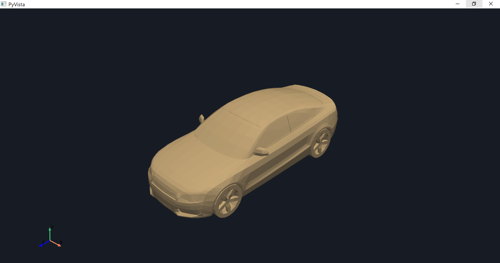
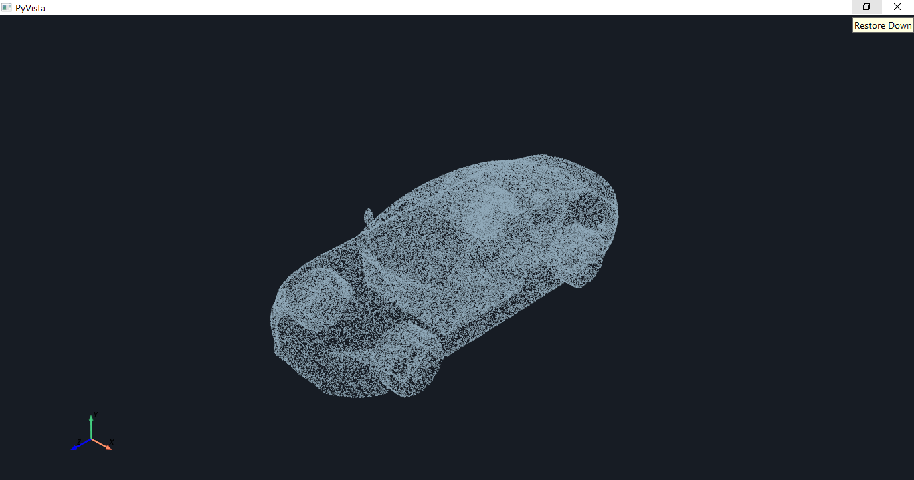
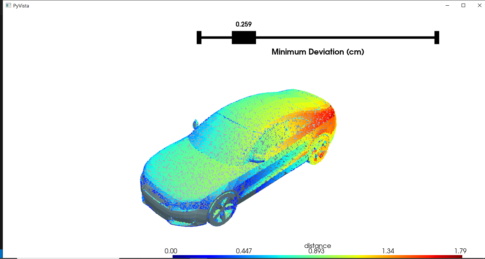
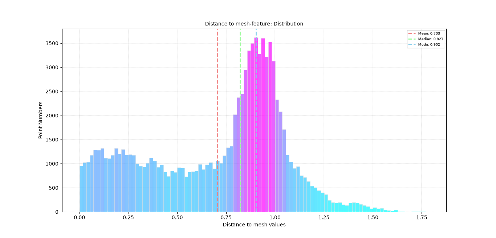

# 3D Point Cloud-to-Mesh Distance Analysis

Analyze geometric deviations between a scanned 3D point cloud and a reference CAD mesh using **Open3D**, **PyVista**, **NumPy**, and **Matplotlib**. The project computes point-to-mesh distances, visualizes deviations using distance-based color mapping, and provides interactive threshold-based point cloud segmentation.

---

## Preview

### Reference CAD Model

<p align="center">

</p>

### Scanned Point Cloud

<p align="center">

</p>

### Distance Visualization and Interactive Segmentation

<p align="center">

</p>

### Distance Distribution Histogram

<p align="center">

</p>

---

## Features

- Load 3D scanned point clouds and reference CAD meshes
- Point-to-mesh distance computation using Open3D RaycastingScene
- Distance-based point cloud visualization
- Interactive minimum deviation thresholding
- Dynamic point cloud segmentation
- Distance distribution histogram
- Mean, median, and mode calculation
- Export distance histogram

---

## Project Structure

```text
point-cloud-to-mesh-distance-analysis/
│
├── data/
│   ├── pcd_car.ply
│   └── mesh_car.ply
│
├── outputs/
│   └── README.md
│
├── assets/
│   ├── cad_model.png
│   ├── scanned_point_cloud.png
│   ├── minimum_deviation.png
│   └── distance_histogram.png
│
├── src/
│   └── main.py
│
├── config.yaml
├── requirements.txt
├── README.md
├── LICENSE
└── .gitignore
```

---

## Workflow

```text
Load Configuration
        │
        ▼
Load Point Cloud and Reference Mesh
        │
        ▼
Create Tensor Triangle Mesh
        │
        ▼
Initialize Raycasting Scene
        │
        ▼
Compute Point-to-Mesh Distances
        │
        ▼
Attach Distances to Point Cloud
        │
        ▼
Distance-Based Visualization
        │
        ▼
Interactive Minimum Deviation Slider
        │
        ▼
Point Cloud Segmentation
        │
        ▼
Generate Distance Distribution Histogram
        │
        ▼
Calculate Statistical Measures
```

---

## Requirements

- Python 3.10+
- Open3D
- PyVista
- NumPy
- Matplotlib
- PyYAML

Install dependencies:

```bash
pip install -r requirements.txt
```

---

## Configuration

All input paths and visualization parameters are stored in **config.yaml**.

Example:

```yaml
# Input Data
input_pcd_path: "data/pcd_car.ply"
input_mesh_path: "data/mesh_car.ply"

# Visualization
point_size: 2

# Output
histogram_output_path: "outputs/distance_to_mesh_histogram.png"
```

| Parameter | Description |
|-----------|-------------|
| `input_pcd_path` | Input scanned point cloud |
| `input_mesh_path` | Reference CAD triangle mesh |
| `point_size` | Point size used for visualization |
| `histogram_output_path` | Output path for the distance histogram |

---

## Usage

Run the project:

```bash
python src/main.py
```

The program loads the scanned point cloud and reference CAD mesh, computes the distance of each point to the reference mesh surface, and visualizes the results using a distance-based color map.

An interactive slider allows users to specify a minimum deviation threshold and dynamically segment the point cloud based on the selected distance.

Finally, a histogram is generated to show the distribution of point-to-mesh distances alongside their statistical measures.

---

## Distance Computation

### Point-to-Mesh Distance

The project uses Open3D's **RaycastingScene** to calculate the distance between each point in the scanned point cloud and the closest location on the reference triangle mesh surface.

```text
d(p, M) = min ||p - q||
          q ∈ M
```

Where:

- `p` represents a point in the scanned point cloud.
- `M` represents the reference mesh surface.
- `q` represents the closest point on the mesh surface.
- `d(p, M)` represents the minimum distance from the point to the mesh.

The resulting distances are stored as point attributes and used for visualization and segmentation.

---

## Interactive Segmentation

The project provides an interactive slider labelled **Minimum Deviation**.

Users can adjust the threshold to extract points whose distances from the reference mesh are greater than or equal to the selected value.

```python
mask = pcd_pv["distance"] >= threshold
```

The visualization updates dynamically as the threshold changes, allowing users to isolate regions with larger geometric deviations.

---

## Distance Distribution Analysis

A histogram is generated using the computed point-to-mesh distances.

The histogram provides an overview of how the deviations are distributed across the scanned point cloud.

The following statistical measures are calculated:

| Statistic | Description |
|-----------|-------------|
| `Mean` | Average point-to-mesh distance |
| `Median` | Middle value of the distance distribution |
| `Mode` | Lower edge of the most populated histogram bin |

The mean, median, and mode are displayed as vertical reference lines on the histogram.

---

## Output

The project generates a distance distribution histogram and provides an interactive visualization for exploring point-to-mesh deviations.

Example:

```text
outputs/
└── distance_to_mesh_histogram.png
```

---

## Future Improvements

- Signed point-to-mesh distance computation
- Tolerance-based geometric inspection
- Export point-wise distance values to CSV
- Export segmented point clouds
- Statistical deviation reporting
- Optimization for large-scale point clouds

---

## License

This project is licensed under the MIT License.

---

## Author

**Faisal Ajao**

Passionate about 3D Computer Vision, point cloud processing, and machine learning. Interested in building intelligent systems through spatial AI, 3D data intelligence, and 3D deep learning.
